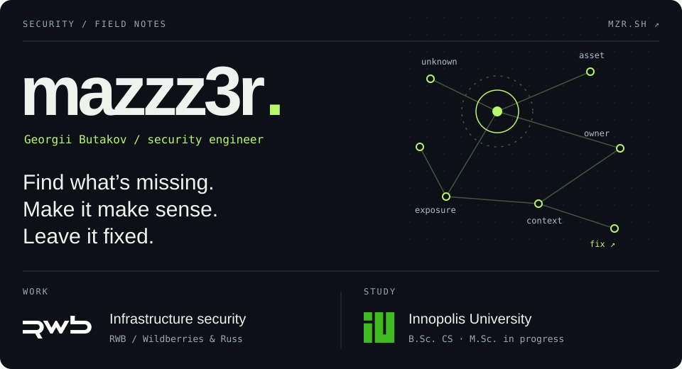

I find the assets nobody has on record, work out who owns them and follow their vulnerabilities through to the fix. When a scanner doesn't cover something, I build the missing piece. When that scanner is open source, I send the fix upstream.

### 01 / Find the blind spots

My work lives between **offensive security and infrastructure vulnerability management**. Previously: pentests, OSINT, social engineering and incident investigations at Innopolis University. Now: making sense of the infrastructure at RWB (Wildberries & Russ), including systems that arrive through acquisitions.

A few things I've built for that work:

- **Shadow IT discovery.** A scanner and a process for finding assets and services missing from the inventory.
- **Perimeter monitoring.** A scanner that watches open ports on the external perimeter.
- **Asset enrichment.** A tool that connects an asset to its owner and context, used by VM, SOC and AppSec.

### 02 / Give something back

I contribute to **[ProjectDiscovery](https://github.com/projectdiscovery)**, including **naabu, nuclei and httpx**. The fixes come from using these tools against real infrastructure.

| Tool | A contribution that's been merged |
| :--- | :--- |
| **naabu** | [Make stream mode respect the exclusion list](https://github.com/projectdiscovery/naabu/pull/1781) |
| **nuclei** | [Pin a target to a specific IP](https://github.com/projectdiscovery/nuclei/pull/7863) |
| **httpx** | [Support IP-pinned targets in JSON input](https://github.com/projectdiscovery/httpx/pull/2691) |

More upstream work

- **naabu:** [OS fingerprints in output](https://github.com/projectdiscovery/naabu/pull/1787), [upload chunk boundaries](https://github.com/projectdiscovery/naabu/pull/1785), [standalone dashboard uploads](https://github.com/projectdiscovery/naabu/pull/1783), [timeout parsing](https://github.com/projectdiscovery/naabu/pull/1765).
- **nuclei:** [randomised payload combinations](https://github.com/projectdiscovery/nuclei/pull/7914), [template info placeholders](https://github.com/projectdiscovery/nuclei/pull/7940), [progress reporting](https://github.com/projectdiscovery/nuclei/pull/7861).
- **httpx:** [configurable metrics port](https://github.com/projectdiscovery/httpx/pull/2666).
- **fastdialer:** [cache keys for pinned IPs](https://github.com/projectdiscovery/fastdialer/pull/580).
- **clistats:** [caller-provided metrics](https://github.com/projectdiscovery/clistats/pull/122).

[All my ProjectDiscovery pull requests →](https://github.com/pulls?q=is%3Apr+author%3Amazzz3r+org%3Aprojectdiscovery)

### 03 / Follow the curiosity

I've also reported a vulnerability that's currently **under triage**.
<!-- Add the CVE identifier and public advisory once confirmed. Do not infer severity or disclosure status. -->

Outside the day job, I explore **agentic coding, autonomous agents and OSINT**. I like tools that turn an investigation into something repeatable.

---

**More of the picture:** [mzr.sh ↗](https://mzr.sh)

**Start a conversation:** [Telegram](https://t.me/mazzz3r) · [Email](mailto:contact@mzr.su) · [LinkedIn](https://www.linkedin.com/in/mazzz3r/)

<!-- Logo sources and attribution: assets/SOURCES.md. -->
